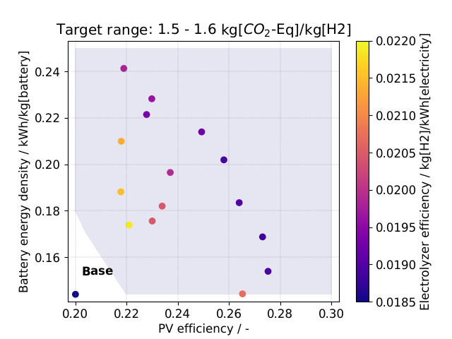
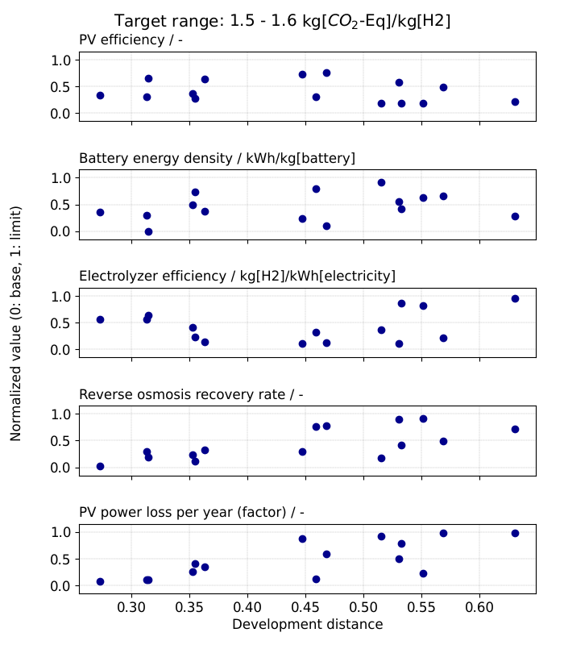

====================
Monte Carlo Analysis
====================

.. contents:: Table of Contents
    :depth: 2
    :local:

Overview
========

:class:`~pyH2A.Analysis.Monte_Carlo_Analysis.Monte_Carlo_Analysis` varies selected input parameters
of a model randomly between their base value and a limit value (e.g. a projected future value) and
evaluates the full model (techno-economic analysis and/or life cycle assessment) for each set of
parameter values. Any dependent variable of the model can be analyzed, for example the levelized
cost of the product or an impact category of the life cycle assessment.

The samples are analyzed with respect to a target range of the dependent variable. For each sample
within the target range, the *development distance* is calculated, which quantifies how far the
parameters have to be moved from their base values towards their limit values to reach the target
range.

The results are saved together with all information required to interpret them (parameters,
dependent variable, random seed, pyH2A version, ...) in a single NumPy ``.npz`` file. Saved results
can be analyzed again (e.g. with a different target range or different parameter names) without
evaluating the model again.

Input
=====

The analysis is requested by including a ``# Monte_Carlo_Analysis`` table in the input file. It
requires two further tables, ``# Dependent variable`` and ``# Parameters - Monte_Carlo_Analysis``.

Dependent variable
------------------

.. code-block:: markdown

	# Dependent variable

	Name | Path to variable | Variable unit | Target range
	--- | --- | --- | ---
	Global warming potential (GWP100) | Dependent Variables > Climate change: fossil - Global warming potential (GWP100) > Value | kg[$CO_{2}$-Eq]/kg[H2] | 1.5; 1.6

- The row name (first column) is the **name** of the dependent variable.
- ``Path to variable`` is the path to the dependent variable in the processed input, i.e. after the
  model has been evaluated. The levelized cost is found at ``Dependent Variables > Levelized cost >
  Value``, LCA results at ``Dependent Variables > <impact category> > Value`` (see
  :doc:`lca_guide`).
- ``Variable unit`` is the unit in which the dependent variable is analyzed and displayed. It has to
  be compatible with the unit of the calculated quantity, including bracketed references (e.g.
  ``kg[$CO_{2}$-Eq]/kg[H2]``).
- ``Target range`` is specified as ``lower; upper`` in ``Variable unit``.

Plots label the dependent variable as ``name / unit``, e.g. "Global warming potential (GWP100) /
kg[$CO_{2}$-Eq]/kg[H2]". Only the first row of the table is used.

Monte_Carlo_Analysis
--------------------

.. code-block:: markdown

	# Monte_Carlo_Analysis

	Name | Value
	--- | ---
	Samples | 50000
	Random seed | 2026
	Output File | Monte_Carlo_Results.npz

.. list-table::
   :header-rows: 1
   :widths: 20 80

   * - Name
     - Description
   * - ``Samples``
     - Number of samples. Required if new results are computed.
   * - ``Random seed``
     - Optional seed of the random number generator. If it is not specified, a seed is drawn,
       printed and stored in the results file.
   * - ``Output File``
     - Path to the ``.npz`` file in which newly computed results are saved.
   * - ``Input File``
     - Path to an ``.npz`` file with previously computed results. If specified, the results are
       read instead of being computed (see `Analyzing saved results`_) and ``Samples``,
       ``Random seed`` and ``Output File`` are ignored.

Either ``Output File`` or ``Input File`` has to be specified. Relative paths refer to the directory
from which pyH2A is run.

Parameters - Monte_Carlo_Analysis
---------------------------------

.. code-block:: markdown

	# Parameters - Monte_Carlo_Analysis

	Name | Parameter path | Type | Values
	--- | --- | --- | ---
	PV efficiency / - | Photovoltaic > Efficiency > Value | value | Base; 0.3
	Battery energy density / kWh/kg[battery] | Battery > Energy density > Value | value | Base; 0.25
	PV power loss per year (factor) / - | Photovoltaic > Power loss per year > Value | factor | Base; 0.5

- The row name (first column) is the **name** of the parameter, which is used for plotting. It
  should contain the unit of the parameter, e.g. ``PV efficiency / -``.
- ``Parameter path`` is the path to the parameter in the input file (``Table > Row > Column``,
  without braces and unit, since the value is changed in place).
- ``Type`` is either ``value`` or ``factor``. Sampled ``value`` parameters replace the base value
  of the parameter (in the unit used in the input file). Sampled ``factor`` parameters are
  multiplied with the base value.
- ``Values`` consists of the base value and the limit value of the parameter (order is irrelevant).
  The base value can be specified as ``Base`` (or ``Reference``), which refers to the value in the
  input file. For ``factor`` parameters, the base value is a factor of 1.

The order of the parameters determines how they are displayed: in
:meth:`~pyH2A.Analysis.Monte_Carlo_Analysis.Monte_Carlo_Analysis.plot_colored_scatter`, the first
parameter is shown on the x axis, the second one on the y axis and the third one as color.

Example
-------

The following input file (``src/tests/Analysis/Monte_Carlo/PV_E_Monte_Carlo_Test.md``) analyzes the
global warming potential of hydrogen from photovoltaics and electrolysis. It merges the model, defines
the analysis and requests plots (see `Plots`_):

.. code-block:: markdown

	# Input files to merge

	Name | Value
	--- | ---
	PV-E Base Model | src/tests/e2e_lca/data/PV_E/PV_E_TEA_LCA.md
	Default TEA + LCA | pyH2A.Config~Defaults_TEA_LCA.md

	# Dependent variable

	Name | Path to variable | Variable unit | Target range
	--- | --- | --- | ---
	Global warming potential (GWP100) | Dependent Variables > Climate change: fossil - Global warming potential (GWP100) > Value | kg[$CO_{2}$-Eq]/kg[H2] | 1.5; 1.6

	# Monte_Carlo_Analysis

	Name | Value
	--- | ---
	Samples | 50
	Random seed | 2026
	Output File | src/tests/Analysis/Monte_Carlo/Monte_Carlo_Results.npz

	# Parameters - Monte_Carlo_Analysis

	Name | Parameter path | Type | Values
	--- | --- | --- | ---
	PV efficiency / - | Photovoltaic > Efficiency > Value | value | Base; 0.3
	Battery energy density / kWh/kg[battery] | Battery > Energy density > Value | value | Base; 0.25
	Electrolyzer efficiency / kg[H2]/kWh[electricity] | Electrolyzer > Hydrogen yield per unit energy > Value | value | Base; 0.022
	Reverse osmosis recovery rate / - | Reverse Osmosis > Recovery rate > Value | value | Base; 80%
	PV power loss per year (factor) / - | Photovoltaic > Power loss per year > Value | factor | Base; 0.5

	# Methods - Monte_Carlo_Analysis

	Name | Method Name | Arguments
	--- | --- | ---
	colored_scatter | plot_colored_scatter | {'save': True, 'pdf': False}
	target_parameters_by_distance | plot_target_parameters_by_distance | {'save': True, 'pdf': False}

Running the analysis
====================

The analysis is performed when pyH2A is run with the input file, either from the command line
(``pyH2A run -i input.md -o output_directory``) or from Python:

.. code-block:: Python

	from pyH2A.run_pyH2A import pyH2A

	result = pyH2A('input.md', 'output_directory')
	monte_carlo = result.meta_modules['Monte_Carlo_Analysis']['Module']

	monte_carlo.results            # parameter values (one column per parameter) and dependent variable (last column)
	monte_carlo.target_range_data  # samples within the target range, sorted by the dependent variable
	monte_carlo.distances          # development distances of these samples

The model is evaluated in parallel on all available CPUs. The parameter values are drawn from
uniform distributions, parameter by parameter in table order, with
``numpy.random.default_rng(random_seed).uniform(lower, upper, samples)``. Hence, the same random seed
reproduces the same samples (the NumPy version is stored in the results file, since NumPy does not
guarantee identical random streams across all of its versions).

Results file
============

The results file is a NumPy ``.npz`` file with three entries:

.. list-table::
   :header-rows: 1
   :widths: 30 70

   * - Entry
     - Content
   * - ``parameter_values``
     - Sampled parameter values, array of shape (samples, parameters).
   * - ``dependent_variable_values``
     - Dependent variable of each sample, array of shape (samples,).
   * - ``metadata``
     - JSON string with the metadata of the results.

The metadata contain ``File format version``, ``pyH2A version``, ``NumPy version``, ``Created``
(time stamp), ``Input file``, ``Samples``, ``Random seed``, the ``Dependent variable`` (``Name``,
``Path``, ``Unit``, ``Target range``) and ``Parameters``, a list with one entry for each column of
``parameter_values`` (``Name``, ``Path``, ``Type``, ``Values``, ``Reference``, ``Limit``).

The file can be read without pyH2A (only NumPy is required) or with
:func:`~pyH2A.Analysis.Monte_Carlo_Analysis.read_results_file`:

.. code-block:: Python

	import json
	import numpy as np
	import pandas as pd

	with np.load('Monte_Carlo_Results.npz') as data:
		parameter_values = data['parameter_values']
		dependent_variable_values = data['dependent_variable_values']
		metadata = json.loads(data['metadata'].item())

	# Alternatively:
	# from pyH2A.Analysis.Monte_Carlo_Analysis import read_results_file
	# parameter_values, dependent_variable_values, metadata = read_results_file('Monte_Carlo_Results.npz')

	table = pd.DataFrame(parameter_values, columns = [parameter['Name'] for parameter in metadata['Parameters']])
	table[metadata['Dependent variable']['Name']] = dependent_variable_values

Analyzing saved results
=======================

If ``Input File`` is specified, the results are read from the file and the model is not evaluated
(except for the grid used by
:meth:`~pyH2A.Analysis.Monte_Carlo_Analysis.Monte_Carlo_Analysis.plot_colored_scatter`). The
``Dependent variable`` and ``Parameters - Monte_Carlo_Analysis`` tables are still read from the
input file and matched to the stored results:

- Parameters are matched by their ``Parameter path``. They can therefore be **renamed and
  reordered**, for example to change the axes of the plots.
- The ``Target range`` can be changed.
- The ``Variable unit`` can be changed to any compatible unit (e.g. ``g[$CO_{2}$-Eq]/kg[H2]``
  instead of ``kg[$CO_{2}$-Eq]/kg[H2]``), the stored values are converted.
- The parameters (their paths, ``Type`` and ``Values``, including the base values in the input
  file) and the path of the dependent variable have to be identical to the ones used to compute the
  results. Otherwise, an error is raised and the results have to be recomputed.

Changes of other inputs of the model after the results were computed cannot be detected.

Development distance
====================

For each sample, the parameter values are normalized so that the base value of each parameter
corresponds to 0 and its limit value to 1. The development distance is the distance of the
normalized sample from the base case (by default the cityblock distance), divided by the number of
parameters, so that it lies between 0 (base case) and 1 (all parameters at their limit values).
Development distances are calculated for the samples within the target range
(:meth:`~pyH2A.Analysis.Monte_Carlo_Analysis.Monte_Carlo_Analysis.development_distance`) and for all
samples (:meth:`~pyH2A.Analysis.Monte_Carlo_Analysis.Monte_Carlo_Analysis.full_distance_cost_relationship`).
Log normalization and other distance metrics can be selected via their arguments.

Plots
=====

Plots are requested with a ``# Methods - Monte_Carlo_Analysis`` table (see :doc:`guide`). The
dependent variable is labelled with its name and unit, parameters with their names.

.. list-table::
   :header-rows: 1
   :widths: 40 60

   * - Method
     - Content
   * - :meth:`~pyH2A.Analysis.Monte_Carlo_Analysis.Monte_Carlo_Analysis.plot_complete_histogram`
     - Histogram of the dependent variable of all samples.
   * - :meth:`~pyH2A.Analysis.Monte_Carlo_Analysis.Monte_Carlo_Analysis.plot_colored_scatter`
     - Samples within the target range (first parameter on the x axis, second on the y axis, third
       as color). The shaded area shows where the target range is reached when all other parameters
       are at their limit values, evaluated on a grid with ``grid_points`` points per axis.
   * - :meth:`~pyH2A.Analysis.Monte_Carlo_Analysis.Monte_Carlo_Analysis.plot_colored_scatter_3D`
     - 3D version of the colored scatter plot (fourth parameter on the z axis).
   * - :meth:`~pyH2A.Analysis.Monte_Carlo_Analysis.Monte_Carlo_Analysis.plot_distance_histogram`
     - Histogram of the development distances of the samples within the target range, with
       parameter table.
   * - :meth:`~pyH2A.Analysis.Monte_Carlo_Analysis.Monte_Carlo_Analysis.plot_distance_cost_relationship`
     - Dependent variable of all samples against their development distance, with smoothed trend
       line, target range and parameter table.
   * - :meth:`~pyH2A.Analysis.Monte_Carlo_Analysis.Monte_Carlo_Analysis.plot_target_parameters_by_distance`
     - Normalized parameter values (0: base, 1: limit) of the samples within the target range
       against their development distance, one panel per parameter.

Figures are saved as ``<name>_<input file name>.pdf`` (or ``.png`` if ``pdf`` is ``False``) in
the output directory if ``save`` is ``True``. Since parameter names contain units, they can be
long: the layout can be adjusted with ``plot_kwargs`` (e.g. ``fig_width``, ``left``, ``right``) and
the parameter table with ``table_kwargs`` (e.g. ``colWidths``, ``fontsize``), see the
``Arguments - MC Analysis`` tables in ``src/tests/Analysis/Monte_Carlo/PV_E_Monte_Carlo_Test.md``.

   Colored scatter plot of the example input file.

   Normalized parameter values against development distance for the example input file.

Changes compared to previous versions
=====================================

- The target range is specified in the ``Dependent variable`` table (``Target range``) instead of
  ``Monte_Carlo_Analysis > Target Price Range ($)``, and any dependent variable can be analyzed.
- In ``Parameters - Monte_Carlo_Analysis``, the first column is the name of the parameter and the
  path is specified in the ``Parameter path`` column. The ``File Index`` column is no longer
  required, since saved results are matched to the parameters by their path.
- Results are saved in ``.npz`` files including their metadata. Results saved as text files by
  previous versions cannot be read and have to be recomputed.
